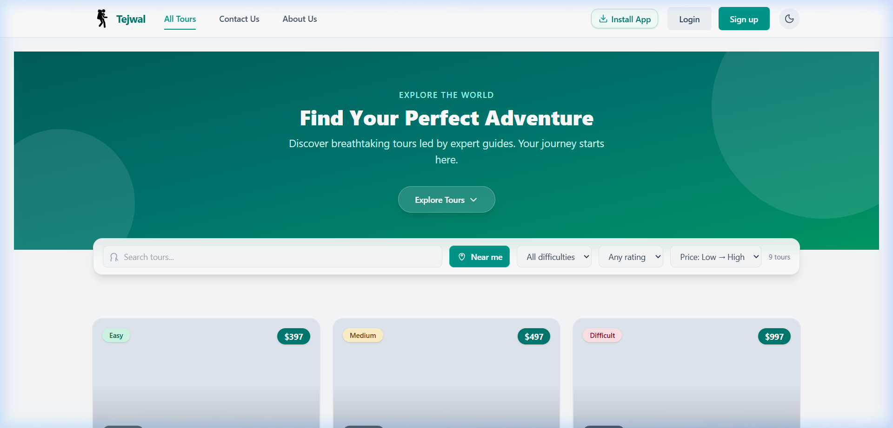
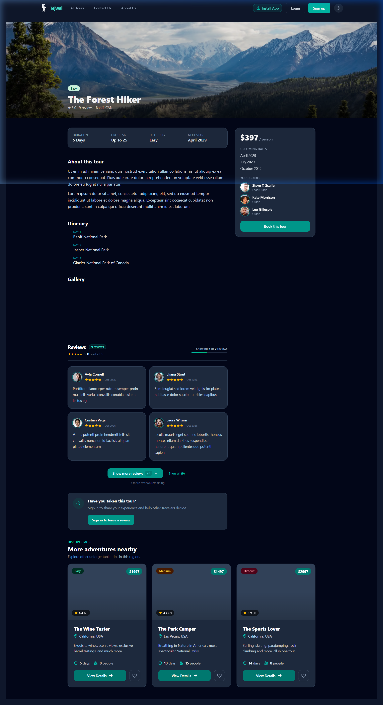
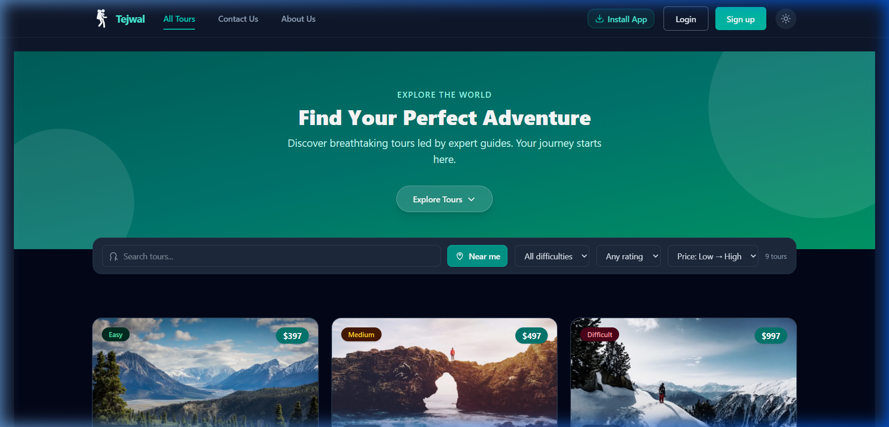
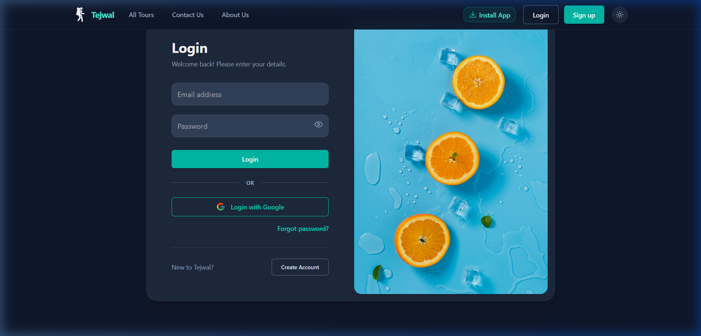
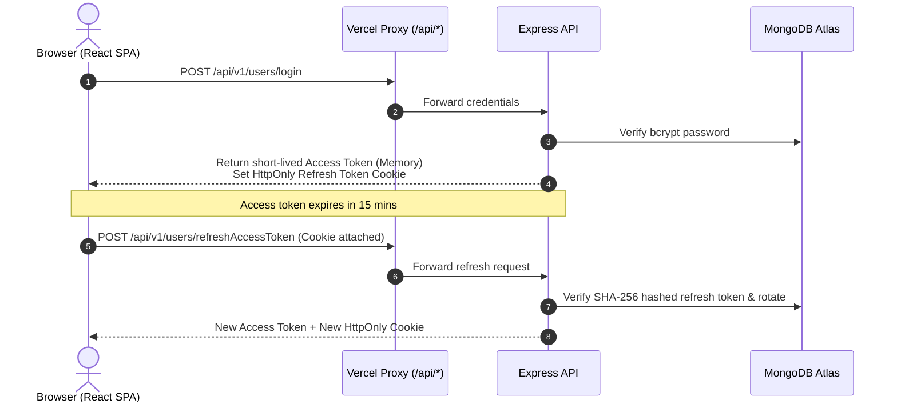
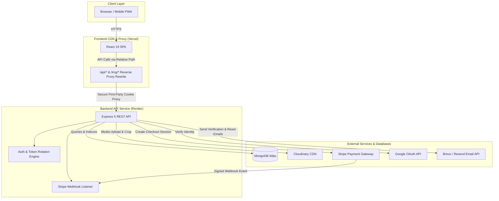

# 🌲 Tejwal (تجوال) — Full-Stack Tour Booking Platform & PWA

<div align="center">

[](https://naturs-front-end.vercel.app/)
[](https://react.dev/)
[](https://www.typescriptlang.org/)
[](https://vitejs.dev/)
[](https://tailwindcss.com/)
[](https://web.dev/progressive-web-apps/)
[](LICENSE)

<br />

**A production-grade tour booking experience built with modern web technologies, offline-first PWA capabilities, enterprise-grade authentication, and seamless Stripe checkout integration.**

[**Explore Live Demo »**](https://naturs-front-end.vercel.app/)

[Report Bug](https://github.com/3liElmorshdy/Naturs-FrontEnd/issues) · [Request Feature](https://github.com/3liElmorshdy/Naturs-FrontEnd/issues)

</div>

---

## 📖 Overview

**Tejwal (تجوال)** is a modern, high-performance tour discovery and booking platform. Users can search and filter adventures, find tours closest to their physical location using geolocation, save favorites to a personal wishlist, make real-time reservations via Stripe Checkout, and manage their trips effortlessly. 

The application is installable as a **Progressive Web App (PWA)** with responsive light/dark themes and an offline-ready service worker shell.

> 💡 **Project Heritage & Evolution:**  
> The core REST API originated from the classic *Natours* project in Jonas Schmedtmann's Node.js bootcamp. It has been entirely rebuilt and expanded into a full-scale production system featuring:
> - A modern **React 19 + TypeScript + Tailwind CSS 4** client.
> - **Google OAuth 2.0** alongside traditional JWT authentication.
> - **Refresh-token rotation with automatic reuse detection**.
> - **Idempotent Stripe Webhook** architecture preventing duplicate charges.
> - **Lead Guide & Administrator Portal** with multi-step tour wizards and monthly analytics.
> - Cloudinary media processing and comprehensive automated integration test coverage.

---

## 📸 Screenshots Showcase

<div align="center">

| 🏕️ Home & Tour Discovery | 🧭 Immersive Tour Details |
|:---:|:---:|
|  |  |

| 🌙 Sleek Dark Mode | 🔐 Secure Authentication |
|:---:|:---:|
|  |  |

</div>

---

## 🧪 Try It Live

Visit the live deployment at **[https://naturs-front-end.vercel.app/](https://naturs-front-end.vercel.app/)**.

> ⏳ **Free Tier Cold Start Notice:**  
> The backend API is hosted on Render's free tier and may spin down after inactivity. The initial request might take **~30–50 seconds** to wake up. Subsequent requests will be fast and responsive.

### Demo Credentials

You can create your own account instantly or sign in using Google. Alternatively, use these pre-seeded accounts:

| Role | Email | Password | Access Level |
| :--- | :--- | :--- | :--- |
| **Admin** | `admin@natours.io` | `test1234` | Full platform control, user management, tour wizard, analytics |
| **Lead Guide** | `sophie@example.com` | `test1234` | Tour creation & editing, monthly plan review, guide bookings |
| **Regular User** | `laura@example.com` | `test1234` | Tour booking, reviews, wishlist, personal profile |

💳 **Stripe Test Mode:**  
Card payments run in sandbox mode. Use card number `4242 4242 4242 4242` with any future expiry date, any 3-digit CVC, and any postal code. No real charges occur.

---

## ✨ Key Features

### 👤 For Travelers & Explorers
- **Search & Advanced Filtering:** Filter adventures by difficulty, price bracket, duration, and sort by rating or price.
- **Geolocation "Nearby Tours":** Detects the traveler's location and calculates precise distances to tour departure points.
- **Rich Tour Pages:** Interactive itineraries, guide profiles, image showcases, and authentic verified-traveler reviews.
- **One-Click Stripe Checkout:** Secure, end-to-end payment flow with instant booking confirmation.
- **Personal Dashboard:** "My Bookings" trip tracker and a saved **Wishlist** synced with state.
- **Account Self-Service:** Profile photo uploads (Cloudinary), name updates, secure password change, email updates with confirmation links, and soft account deletion.
- **PWA & Offline Support:** Install directly to your home screen or desktop; smooth cached shell powered by Workbox.
- **Dark & Light Mode:** Seamless theme switching with persistent user preference.

### 🛡️ For Administrators & Lead Guides
- **Management Dashboard:** Quick metric overviews tailored to user role (`admin` vs `lead-guide`).
- **Tour Wizard:** Multi-step creator and editor for managing guides, itineraries, start dates, and drag-and-drop cover/gallery images.
- **User Role Management:** Promote or demote users (`user`, `guide`, `lead-guide`, `admin`) and activate/deactivate accounts.
- **Monthly Tour Analytics:** Visual monthly scheduling and traveler capacity planning.
- **Bookings Oversight:** Live searchable table of all user bookings, payment statuses, and tour assignments.

---

## 🔐 Security Engineering Highlights

Security was engineered into the core architecture rather than applied as an afterthought:



- **In-Memory Access Tokens:** Short-lived access tokens remain solely in client memory (Redux), shielding them from XSS storage extraction.
- **HttpOnly Refresh Cookies:** Refresh tokens live strictly inside `httpOnly`, `secure`, `SameSite=Strict` cookies inaccessible to JavaScript.
- **Refresh Token Rotation & Reuse Detection:** Every refresh issues a new token pair. If an expired or already-used token is submitted, the entire token family is immediately revoked to thwart token replay attacks.
- **SHA-256 Database Hashing:** Refresh tokens, password-reset tokens, and email-verification links are hashed using SHA-256 prior to storage.
- **First-Party Cookie Preservation:** The React SPA leverages Vercel rewrites to proxy `/api/*` requests directly to Render. This ensures cookies are treated as first-party, preventing Safari and iOS Intelligent Tracking Prevention (ITP) from blocking auth cookies.
- **Idempotent Stripe Webhooks:** Webhook events verify Stripe cryptographic signatures and record unique transaction IDs to guarantee bookings are never processed twice.
- **Defensive Middleware:** Strict CORS policies, Helmet HTTP headers, rate limiting (global + strict auth throttles), mongo-sanitize (NoSQL injection prevention), and XSS sanitization.

---

## 🧱 Tech Stack

### Frontend Architecture
| Category | Technology | Description |
| :--- | :--- | :--- |
| **Framework** | [React 19](https://react.dev/) | Modern UI library utilizing React compiler and hooks |
| **Language** | [TypeScript 5](https://www.typescriptlang.org/) | Type-safe code with strict compilation standards |
| **Build Tool** | [Vite 8](https://vitejs.dev/) | Ultra-fast HMR and bundle optimization |
| **Styling** | [Tailwind CSS 4](https://tailwindcss.com/) | Modern utility-first CSS framework with native dark mode |
| **Server State** | [TanStack React Query v5](https://tanstack.com/query) | Declarative caching, optimistic updates, and background refetching |
| **Client State** | [Redux Toolkit](https://redux-toolkit.js.org/) | Global authentication and wishlist state management |
| **Routing** | [React Router v7](https://reactrouter.com/) | Declarative route protection, layout wrappers, and lazy-loaded bundles |
| **Forms & Validation** | [React Hook Form](https://react-hook-form.com/) + [Zod](https://zod.dev/) | Robust form handling with schema-driven validation |
| **Icons & UI** | [Lucide React](https://lucide.dev/) + [React Hot Toast](https://react-hot-toast.com/) | Clean SVG icons and accessible notification popups |
| **PWA** | [Vite Plugin PWA](https://vite-pwa-org.netlify.app/) | Service worker registration with Workbox runtime caching |

### Backend & Cloud Architecture
| Category | Technology | Description |
| :--- | :--- | :--- |
| **Runtime & Server** | Node.js 20+ · Express 5 | Asynchronous RESTful API backend |
| **Database** | MongoDB · Mongoose 8 | Document database with virtual populates and schema indices |
| **Payments** | Stripe Checkout & Webhooks | Hosted checkout sessions with signed asynchronous event handlers |
| **Authentication** | JWT · Google OAuth 2.0 · bcrypt | Role-based authorization (`restrictTo`) and password hashing |
| **Media Pipeline** | Cloudinary · Multer · Sharp | Multi-file uploads, image resizing, and CDN asset delivery |
| **Email Service** | Brevo / Resend API | Transactional emails for email confirmation and password resets |
| **Hosting** | Vercel (Client) · Render (API) · Atlas | High-availability cloud deployment with automated CD |

---

## 🏗️ System Architecture



---

## 🚀 Local Development Setup

### Prerequisites
- [Node.js](https://nodejs.org/) (version `>= 20.0.0`)
- [npm](https://www.npmjs.com/) or [pnpm](https://pnpm.io/)
- A free [MongoDB Atlas](https://www.mongodb.com/cloud/atlas) cluster or local MongoDB instance
- [Stripe CLI](https://stripe.com/docs/stripe-cli) (optional, for local webhook testing)

### 1. Clone the Repositories

```bash
# Clone the frontend repository
git clone https://github.com/3liElmorshdy/Naturs-FrontEnd.git
cd Naturs-FrontEnd
```

### 2. Frontend Installation & Startup

```bash
# Install dependencies
npm install

# Create environment configuration
cp .env.example .env
```

Configure your frontend `.env`:
```env
VITE_API_ORIGIN=https://naturs-1.onrender.com
VITE_CONTACT_EMAIL=alielmorshedy10@gmail.com
VITE_APP_NAME=Tejwal
```

Start the Vite development server:
```bash
npm run dev
```
Open [http://localhost:5173](http://localhost:5173) in your browser.

---

### 3. Backend Setup (Reference)

```bash
# Inside your backend repository:
npm install
cp .env.example .env
npm start
```

#### Backend Environment Variables Reference:

| Variable | Description |
| :--- | :--- |
| `NODE_ENV` | `development` or `production` |
| `PORT` | API port (default: `5020`) |
| `DATABASE` | MongoDB connection URI string |
| `FRONTEND_URL` | Client origin for CORS and email links (`http://localhost:5173`) |
| `JWT_ACCESS_SECRET` / `JWT_ACCESS_EXPIRES_IN` | Access token signing key and lifetime (e.g., `15m`) |
| `JWT_SECRET` / `JWT_EXPIRES_IN` / `JWT_COOKIE_EXPIRES_IN` | Refresh token secret, validity, and cookie duration (e.g., `30d`) |
| `STRIPE_SECRET_KEY` / `STRIPE_WEBHOOK_SECRET` | Stripe API credentials and webhook secret |
| `GOOGLE_CLIENT_ID` / `GOOGLE_CLIENT_SECRET` | Google Cloud OAuth 2.0 application credentials |
| `CLOUDINARY_CLOUD_NAME` / `CLOUDINARY_API_KEY` / `CLOUDINARY_API_SECRET` | Media storage cloud credentials |
| `BREVO_API_KEY` / `EMAIL_USER` / `EMAIL_FROM_NAME` | Transactional email provider settings |

#### Local Stripe Webhook Testing
```bash
stripe listen --forward-to localhost:5020/api/v1/bookings/webhook-checkout
```

---

## 📂 Project Structure

```
NatursFront/
├── docs/
│   └── screenshots/         # Showcase screenshots for README
├── public/
│   ├── favicon.svg
│   ├── pwa-192x192.png      # PWA app icons
│   ├── pwa-512x512.png
│   └── robots.txt
├── src/
│   ├── assets/              # Static SVG and image assets
│   ├── components/          # Reusable UI building blocks
│   │   ├── Avatar/
│   │   ├── Button/
│   │   ├── InstallButton/   # PWA install prompt trigger
│   │   ├── NavBar/
│   │   ├── ProtectedRoute/  # RBAC route guarding
│   │   ├── ThemeToggle/     # Light / Dark mode switcher
│   │   ├── TourCard/
│   │   └── TourFilters/     # Search & category filters
│   ├── config.ts            # Base API URL configuration
│   ├── constants/           # Roles, endpoints, and static metadata
│   ├── hooks/               # Custom React hooks (auth, PWA, bookings)
│   ├── layout/              # Header, footer, and navigation shell
│   ├── pages/               # Route-level views
│   │   ├── admin/           # Dashboard, Tour Wizard, User Management
│   │   ├── Home/            # Landing page with tour grids
│   │   ├── Login/ & Signup/ # Auth screens with Google OAuth
│   │   ├── MyBooking/       # Traveler booking history
│   │   ├── Profile/         # User settings and photo upload
│   │   ├── ViewDetails/     # Tour itinerary, map, and checkout
│   │   └── Wishlist/        # Saved favorite adventures
│   ├── routes/              # React Router v7 configuration
│   ├── schemas/             # Zod validation schemas
│   ├── services/            # Axios API client instances
│   ├── store/               # Redux Toolkit slices (auth, wishlist)
│   ├── types/               # TypeScript interfaces & types
│   └── utils/               # Formatting, permissions, and token helpers
├── vercel.json              # Reverse proxy rewrites and cache headers
├── vite.config.js           # Vite plugins (Tailwind, React, PWA)
└── package.json
```

---

## 🧪 Testing Suite

```bash
# Run unit & component tests with Vitest
npm test

# Run tests with the interactive Vitest UI
npm run test:ui
```

The backend is backed by an automated integration test suite utilizing `mongodb-memory-server` and `supertest`:
- **Authentication Flows:** Verification links, password resets, role boundary checks.
- **Refresh Token Lifecycle:** Rotation validation, tampered token rejection, and reuse session invalidation.
- **Stripe Webhook Verification:** Signature validation, idempotent retry handling, and booking creation.

---

## 🗺️ Roadmap & Planned Enhancements

- [x] Progressive Web App (PWA) with desktop/mobile installation.
- [x] Token rotation with automatic session reuse revocation.
- [x] Admin dashboard with monthly tour plan analytics.
- [x] Dark / Light adaptive theme mode.
- [ ] Multi-date selection per booking with dynamic tour capacity enforcement.
- [ ] In-app booking cancellation and Stripe refund webhook processing.
- [ ] Internationalization (i18n) with Arabic and English language switcher.
- [ ] Interactive 3D map itinerary visualization using Mapbox GL / MapLibre.

---

## 👨‍💻 Author

**Ali Ahmed (3liElmorshdy)**
- **GitHub:** [@3liElmorshdy](https://github.com/3liElmorshdy)
- **Live Project:** [Tejwal Web App](https://naturs-front-end.vercel.app/)
- **Email:** [alielmorshedy10@gmail.com](mailto:alielmorshedy10@gmail.com)

---

## 📄 License

This project is licensed under the [ISC License](LICENSE).